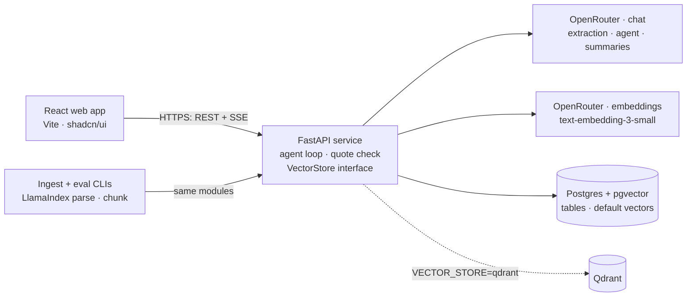

# Lensor

Lensor reviews commercial contracts with LLMs, RAG, and an agent, and it measures its accuracy against real lawyer labels.

> Lensor is a portfolio demo. It does not give legal advice.

[](https://github.com/alienstro/lensor/actions/workflows/ci.yml)

- **Live demo:** _not deployed yet_ (see [docs/deploy.md](docs/deploy.md))
- **Demo video (2 minutes):** _not recorded yet_

## What it does

1. The **Contracts** page shows each contract with a risk score and the reasons for the score.
2. You **upload** a PDF or TXT contract. The page shows each pipeline step: read, split, index, and find clauses.
3. The **contract viewer** marks the 10 clause types in the text. A panel lists each type with the quote, a plain summary, and a risk level, or "Not found".
4. On the **Ask** page, an agent answers questions about all contracts. Each tool call shows as a step, the answer streams in, and each claim links to its source clause.
5. The **Accuracy** page shows how often Lensor finds the same clauses as the lawyers who labelled CUAD.

## Architecture



- The browser talks only to the FastAPI service. The service owns every call to OpenRouter and to the stores.
- Each quote from the LLM must be in the contract text, or the backend drops it. The agent cites `[c:<contract_id>:<start>-<end>]`, and the backend checks each citation against the stored text. A citation that fails the check shows as "Not found in the contract text".
- `VectorStore` has a pgvector adapter (default) and a Qdrant adapter. `VECTOR_STORE` selects one.

## Evaluation

The test uses 50 CUAD contracts that the demo and the prompts never see. A predicted quote matches a lawyer label when the two character spans have a Jaccard score of 0.5 or more.

Measured on 2026-10-27 with prompt version 1:

| Model | Mode | Macro precision | Macro recall | Macro F1 | Cost (USD) |
| --- | --- | --- | --- | --- | --- |
| `deepseek/deepseek-v4.1-flash` | full | 0.70 | 0.84 | 0.73 | 0.29 |
| `deepseek/deepseek-v4.1-flash` | retrieval | 0.61 | 0.67 | 0.62 | 0.25 |

- In full mode, the model reads the whole contract. In retrieval mode, it reads only the 5 best chunks for each clause type, and the F1 falls by 0.11.
- The weak types have a low precision: Uncapped Liability (F1 0.37), Notice Period to Terminate Renewal (0.48) and Non-Compete (0.52). The model marks too much text as these types.
- The strong types are Governing Law (F1 0.99), Anti-Assignment (0.96) and Expiration Date (0.88).

**Retrieval check (recall@5)**

| Clause type | pgvector | Qdrant |
| --- | --- | --- |
| All 10 types (mean) | 0.86 | not run yet |

Change of Control has the lowest recall@5 (0.50). For the other 9 types, the 5 best chunks hold a lawyer label in 78% to 100% of the contracts.

The runs for the other models and the Qdrant check have not run yet. To run them, use these commands:

```bash
docker compose run --rm api python -m lensor.eval --contracts 50 --model anthropic/claude-haiku-5.5
docker compose run --rm api python -m lensor.eval --contracts 50 --model google/gemini-3.1-flash-lite
# Qdrant: set VECTOR_STORE=qdrant, then start Qdrant before the check.
docker compose --profile qdrant up -d
docker compose run --rm api python -m lensor.eval --contracts 50 --mode retrieval --retrieval-check
```

## Risk score

The score is a sum of points, from 0 to 100. Each rule is a fact that the extraction found, so the UI can show each reason.

| Rule | Points |
| --- | --- |
| Uncapped Liability found | 30 |
| Cap on Liability not found | 15 |
| Renewal Term found | 15 |
| Non-Compete found | 15 |
| Change of Control found | 15 |
| Termination for Convenience found | 10 |

High risk is 60 or more. Medium risk is 30 to 59. Low risk is below 30.

## Quick start

You need Docker and an [OpenRouter](https://openrouter.ai) API key.

```bash
cp .env.example .env            # then set OPENROUTER_API_KEY
docker compose up -d --build    # web on http://localhost:8080
scripts/fetch_cuad.sh           # downloads CUAD into data/
docker compose run --rm api python -m lensor.ingest.load_cuad --set demo
```

The load reads 50 contracts and costs less than $1. To use Qdrant, set `VECTOR_STORE=qdrant` and run `docker compose --profile qdrant up -d`.

## Development

| Part | Folder | Stack |
| --- | --- | --- |
| API | `api/` | Python 3.12, FastAPI, SQLAlchemy 2 (async), Alembic, pgvector, qdrant-client, LlamaIndex (parse and chunk only), OpenAI SDK with the OpenRouter base URL |
| Web | `web/` | React 19, TypeScript, Vite, Tailwind CSS 4, shadcn/ui, TanStack Query, React Router |

Run the checks one file at a time:

```bash
docker compose up -d postgres
cd api && uv run ruff check . && uv run mypy src
for f in tests/test_*.py; do uv run pytest "$f" -q; done

cd ../web && npm run lint && npm run typecheck
for f in $(find src -name "*.test.ts*"); do npx vitest run "$f" --maxWorkers=1; done
npm run build
```

No test calls OpenRouter. The tests use `FakeLLMClient` and a mock HTTP transport.

### Changes to the design stack

The design names React 18. The app uses React 19 and React Router 8, because they are the current versions of the Vite template and the app needs no React 18 feature.

## Data and credit

The demo contracts and the evaluation labels come from [CUAD v1](https://www.atticusprojectai.org/cuad) by The Atticus Project, under [CC BY 4.0](https://creativecommons.org/licenses/by/4.0/). The sample contract in `web/public/sample-contract.txt` is fictional.

## Notice

Lensor helps you read contracts faster. It does not give legal advice. Ask a lawyer before you act on a contract.
