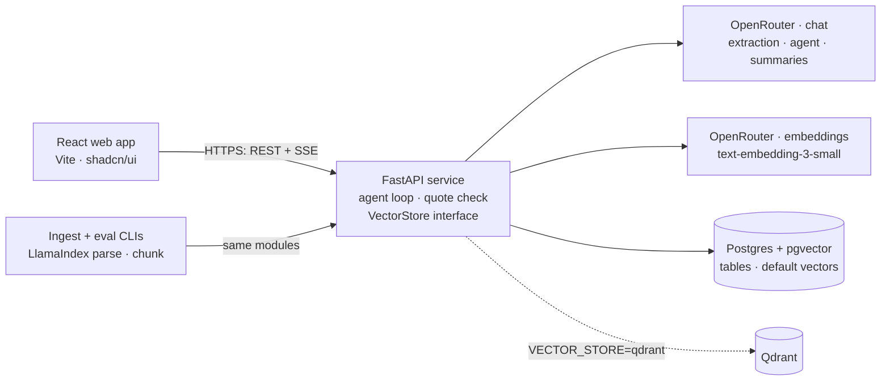

# Lensor Design

As of 2026-10-26. This is the Markdown copy of `2026-10-26-lensor-design.html`. The two files have the same content.

Lensor is a web app that reviews commercial contracts with LLMs through OpenRouter, RAG, and an agent. It uses the public CUAD dataset, so it measures its accuracy against real lawyer labels.

## 1. Purpose

Lensor shows a hiring manager that you can ship a full-stack AI app from an ambiguous brief. The story user is a consultant or a legal operations analyst. This person must review a set of supplier contracts quickly and find the risky clauses.

The app replaces this manual work: read each contract, find each important clause, copy it into a spreadsheet, and compare it with the other contracts.

| Job description line | Lensor feature |
| --- | --- |
| Full-stack web apps | React frontend, FastAPI backend, OpenRouter and vector store integrations |
| Intelligent dashboards | Risk dashboard by contract and by clause type |
| Agentic workflows | Chat agent that calls tools to search, filter, and compare clauses |
| Document processing pipelines | Upload, parse, chunk, embed, and store pipeline |
| Conversational interfaces | Chat panel with cited answers |
| Streaming, structured outputs, tool use | Streamed answers, JSON clause extraction, agent tools |
| Polished, demo-ready UI | Contract viewer with clause highlights |
| RAG, vector search, data pipelines | Cited answers from contract chunks in pgvector |
| Reusable component libraries | `VectorStore` interface with pgvector and Qdrant adapters |
| REST APIs and database concepts | FastAPI REST endpoints and a Postgres schema |
| Vector databases or RAG frameworks | pgvector, Qdrant, and LlamaIndex |
| Cloud or Docker | Docker Compose, then one deploy with Dokploy |
| Ship something tangible | Live demo URL, README with the evaluation score |

## 2. Goals, non-goals, and anti-goals

**Goals**

- A user uploads a contract and sees the extracted clauses in less than 60 seconds.
- Each chat answer cites the contract and the clause text that it uses.
- An evaluation script reports precision and recall per clause type against the CUAD labels.
- One command (`docker compose up`) starts the full app.
- A public demo URL runs with pre-loaded CUAD contracts.

**Non-goals (version 1)**

- Legal advice. The UI shows a "not legal advice" notice.
- User accounts or multi-tenant data. The demo has one shared workspace.
- OCR of scanned PDFs.
- All 41 CUAD clause types. Version 1 uses 10.
- A Pinecone adapter. The interface allows it later.

**Anti-goals (the project fails if these happen, even if the code runs)**

- An answer cites a clause that is not in the contract.
- The README has no measured accuracy score.
- The API key is in the repository, or the demo has no cost limit.
- The infrastructure is larger than the app needs, for example Kubernetes.

## 3. Data

The app uses [CUAD v1](https://www.atticusprojectai.org/cuad) from The Atticus Project: 510 commercial contracts with more than 13,000 lawyer labels across 41 clause types. The license is CC BY 4.0, so the README must credit The Atticus Project.

- **Download:** `CUAD_v1.zip` (105.9 MB) from [Zenodo record 4595826](https://zenodo.org/records/4595826). The [GitHub repository](https://github.com/TheAtticusProject/cuad) also has `data.zip` and `category_descriptions.csv`.
- **Check at ingest time:** the exact file layout inside the zip. The pages that I opened do not list it.
- **Demo set:** 50 contracts, pre-loaded in the public demo.
- **Evaluation set:** 50 different contracts that the demo and the prompts never see.

Version 1 extracts these 10 clause types. The names match the CUAD category names exactly, so the evaluation can compare them with the labels.

| CUAD clause type | Why a reviewer cares |
| --- | --- |
| Expiration Date | When the contract ends |
| Renewal Term | Automatic renewal can lock in cost |
| Notice Period to Terminate Renewal | The last date to stop a renewal |
| Governing Law | Which jurisdiction applies |
| Termination for Convenience | Who can exit without cause |
| Change of Control | What happens after an acquisition |
| Anti-Assignment | Whether a party can transfer the contract |
| Non-Compete | Limits on the business |
| Cap on Liability | The maximum loss |
| Uncapped Liability | Exposure with no limit |

## 4. User flow

1. The user opens the **dashboard**. It shows the 50 demo contracts and a risk score for each one.
2. The user **uploads** a new contract (PDF or TXT). The UI shows the pipeline status: parse, chunk, embed, extract.
3. The app opens the **contract viewer**. It highlights each extracted clause, with a colour per clause type.
4. The side panel lists the 10 clause types, with the clause text, a summary, and a risk flag. It shows "Not found" when the contract has no such clause.
5. The user asks a question in the **chat panel**, for example "Which contracts have uncapped liability and renew automatically?"
6. The agent calls its tools, and the UI shows each tool call as a small step. The answer streams in, with a citation link for each claim.
7. The user clicks a citation. The viewer opens that contract at the cited clause.
8. The user opens the **Evaluation** page. It shows precision and recall per clause type from the last run.

## 5. Architecture

The browser talks only to the FastAPI service. The service owns all calls to OpenRouter and to the stores. An env variable selects the vector store.

## 6. Stack

All choices below are the designer's calls. The builder can change one for a clear reason, and must write the reason in the README.

| Layer | Choice | Reason |
| --- | --- | --- |
| Frontend | React, TypeScript, Vite, Tailwind CSS, shadcn/ui, TanStack Query | The job lists React first. shadcn/ui gives a polished UI fast. |
| Backend | Python 3.12, FastAPI, Pydantic, SQLAlchemy, Alembic | Python is the usual language for RAG work. Pydantic models also define the JSON schemas for structured outputs. |
| LLM gateway | OpenRouter (`https://openrouter.ai/api/v1`), called with the OpenAI Python SDK and a custom `base_url` | One key reaches models from many vendors. The OpenAI-compatible format keeps the code portable. |
| LLM models | Env variables `LLM_MODEL_AGENT`, `LLM_MODEL_EXTRACT`, `LLM_MODEL_SUMMARY`, with exact model ids (see the table below) | Exact ids, not `~…-latest` aliases, keep the evaluation results repeatable. |
| Routing | `provider.require_parameters: true`, `provider.data_collection: "deny"` | Requests go only to providers that support tools and JSON schemas, and that do not keep the data. |
| Streaming | Server-Sent Events | SSE is simpler than WebSockets for one-way token streams. |
| Embeddings | OpenRouter `/embeddings` with `openai/text-embedding-3-small` | The same key and client as the chat calls. A hosted model keeps the 8 GB laptop free. |
| RAG framework | LlamaIndex for parse and chunk only | Write the prompts, the retrieval query, and the agent loop by hand, so that you can explain each one in an interview. |
| Vector store | pgvector (main), Qdrant (second adapter) | One store runs at a time. Two adapters show the skill without a code smell. |
| Database | PostgreSQL 16 with pgvector | One database for relational data and vectors. |
| Tests | pytest, Vitest | Standard tools for each language. |
| Local run | Docker Compose: `web`, `api`, `postgres`, `qdrant` (profile) | One command starts the app. |
| Deploy | Dokploy on the owner's server: the same Compose file, with `pgvector/pgvector:pg16` and Qdrant as containers | One Compose file for the laptop and the server. Dokploy manages the domain and the HTTPS certificate. |
| CI | GitHub Actions: lint, typecheck, tests, Docker build | A green badge in the README shows good practice. |

### Default models and cost

All models below support `tools` and `structured_outputs` on OpenRouter. The prices are OpenRouter list prices on 2026-10-26, in US dollars per 1 million tokens.

| Job | Model id | Input | Output | Reason |
| --- | --- | --- | --- | --- |
| Clause extraction | `deepseek/deepseek-v4.1-flash` | $0.02 | $1.00 | A contract is long input and short output, so the input price matters most. The context is 1M tokens. |
| Chat agent | `openai/gpt-5-mini` | $0.25 | $2.00 | The demo shows the agent most, so it gets a model with reliable tool calls. |
| Summaries | `openai/gpt-5-nano` | $0.05 | $0.40 | A short, simple task. |
| Embeddings | `openai/text-embedding-3-small` | $0.02 | None | 1,536 dimensions. This is below the 2,000-dimension limit of a pgvector HNSW index on the `vector` type. |
| Comparison only | `anthropic/claude-haiku-5.5` | $0.10 | $0.50 | The job names Anthropic. The evaluation compares it with the defaults. |
| Comparison only | `google/gemini-3.1-flash-lite` | $0.25 | $1.50 | A third vendor for the comparison. |

> Estimate: one ingest and extraction of 100 contracts costs less than $1. One evaluation run costs about $1 or less per model. Set a $10 monthly credit limit on the OpenRouter key for the public demo.

## 7. Data model and API

Postgres holds the contracts, the extractions, and the evaluation results. The vector store holds the chunk embeddings, with `contract_id` and character offsets as metadata.

| Table | Main columns |
| --- | --- |
| `contracts` | `id`, `title`, `source`, `text`, `status`, `risk_score`, `created_at` |
| `chunks` | `id`, `contract_id`, `start_char`, `end_char`, `text` |
| `clause_extractions` | `id`, `contract_id`, `clause_type`, `found`, `quote`, `start_char`, `end_char`, `summary`, `risk_level`, `model` |
| `eval_runs` | `id`, `started_at`, `model`, `prompt_version`, `contract_count`, `cost_usd` |
| `eval_results` | `run_id`, `clause_type`, `precision`, `recall`, `f1` |

> The backend checks each `quote` against the contract text before it saves the row. If the quote is not in the text, the backend drops it and logs the event. This check stops invented citations.

| Method | Path | Purpose |
| --- | --- | --- |
| POST | `/api/contracts` | Upload a contract and start the pipeline |
| GET | `/api/contracts` | List contracts with risk scores |
| GET | `/api/contracts/{id}` | Get one contract with its extractions |
| GET | `/api/contracts/{id}/status` | Get the pipeline status (SSE) |
| POST | `/api/chat` | Send a message, get a streamed answer with tool steps (SSE) |
| GET | `/api/dashboard` | Get counts by clause type and risk level |
| GET | `/api/eval/runs/latest` | Get the latest evaluation results |
| GET | `/api/health` | Health check for Dokploy |

## 8. Agent tools

The chat agent is a hand-written tool-calling loop on the OpenRouter chat completions API, in the OpenAI `tools` format. It stops after 8 tool calls per question, so one question cannot run up a large bill. All tools are read-only.

| Tool | Input | Output | Source |
| --- | --- | --- | --- |
| `search_clauses` | `query`, optional `clause_type`, `contract_ids`, `top_k` | Matching chunks with contract title and offsets | Vector store |
| `list_contracts_by_clause` | `clause_type`, `found`, optional `risk_level` | Contract ids and titles | Postgres |
| `get_contract_summary` | `contract_id` | The 10 extracted clauses and the risk score | Postgres |
| `compare_clauses` | `clause_type`, `contract_ids` (2 to 5) | The quotes side by side | Postgres |

The system prompt tells the agent to cite each claim with a `contract_id` and character offsets. The backend turns each citation into a link to the viewer. A citation that does not match stored text shows as "unverified" in the UI.

## 9. Evaluation

The evaluation gives the README its headline number: precision, recall, and F1 per clause type on 50 held-out CUAD contracts.

- **Command:** `python -m lensor.eval --contracts 50` writes the results to `eval_runs` and `eval_results`.
- **Match rule:** a predicted quote matches a label when the two character spans overlap with a Jaccard score of 0.5 or more. "Not found" is correct when the contract has no label of that type.
- **Two variants:** full contract text in the prompt, and retrieved chunks only. The README compares accuracy and cost for both.
- **Model comparison:** the script takes `--model`, so one run per model shows accuracy and cost side by side. OpenRouter makes this a one-line change.
- **Retrieval check:** recall@5 per clause type, for pgvector and for Qdrant.
- **Cost:** the script records the token count and the cost in US dollars for each run.
- **Version tag:** each run stores the `prompt_version`, so a prompt change shows as a new row.

> The evaluation runs by hand, not in CI, because each run calls the paid API.

## 10. Milestones

Each milestone ends with something that you can show. Do them in this order, because each one uses the one before it.

1. **Skeleton.** Docker Compose with `web`, `api`, and `postgres`. The React page calls `/api/health`. CI runs lint and tests.
2. **Ingestion.** A script loads the CUAD contracts. The pipeline parses, chunks, embeds, and stores them in pgvector.
3. **Extraction.** The LLM extracts the 10 clause types as JSON. The quote check runs. The viewer shows the highlights.
4. **Evaluation.** The script runs on 50 contracts. Improve the prompt until the score stops going up, then freeze `prompt_version` 1.
5. **Chat agent.** The tool-use loop, SSE streaming, tool steps in the UI, and citation links.
6. **Dashboard.** The risk scores, the counts by clause type, and the Evaluation page.
7. **Qdrant adapter.** The second `VectorStore` adapter and the recall@5 comparison.
8. **Deploy.** Dokploy on your server, a daily Postgres backup, a $10 credit limit on the OpenRouter key, and a rate limit on `/api/chat`.
9. **Polish.** README with the architecture diagram, the evaluation table, a 2-minute demo video, and the CUAD credit.

## 11. Calls and decisions

**Calls the designer made**

- 10 clause types for version 1, not all 41.
- 50 demo contracts and 50 different evaluation contracts.
- Jaccard 0.5 as the span match rule.
- OpenRouter for chat and embeddings, with `require_parameters` and `data_collection: "deny"`.
- The default models and the $10 monthly credit limit.
- A limit of 8 tool calls per chat question.
- SSE for streaming, not WebSockets.

**Left to the builder**

- The chunk size and the overlap. Pick them with the recall@5 check.
- The risk score formula. Keep it simple and show it in the UI.
- The folder layout and the component names.

**Owner decisions**

- Python (FastAPI) for the backend.
- OpenRouter for all LLM and embedding calls. No direct Claude API.
- Deploy with Dokploy on the owner's own server.
- The GitHub repository is public, so no secret goes in it. Use `.env` files and Dokploy env settings.

## 12. Sources

- [CUAD, The Atticus Project](https://www.atticusprojectai.org/cuad): dataset size, clause count, and license.
- [Zenodo record 4595826](https://zenodo.org/records/4595826): `CUAD_v1.zip`, 105.9 MB, CC BY 4.0.
- [TheAtticusProject/cuad on GitHub](https://github.com/TheAtticusProject/cuad) and [category_descriptions.csv](https://raw.githubusercontent.com/TheAtticusProject/cuad/main/category_descriptions.csv): the 41 category names.
- [OpenRouter API overview](https://openrouter.ai/docs/api-reference/overview): base URL, streaming, tool calling, structured outputs.
- [OpenRouter provider routing](https://openrouter.ai/docs/features/provider-routing): `require_parameters` and `data_collection`.
- [OpenRouter embeddings](https://openrouter.ai/docs/api-reference/embeddings): the `/embeddings` endpoint and model names.
- [OpenRouter models API](https://openrouter.ai/api/v1/models): prices and supported parameters, read on 2026-10-26.

Lensor is a portfolio project and does not give legal advice.
